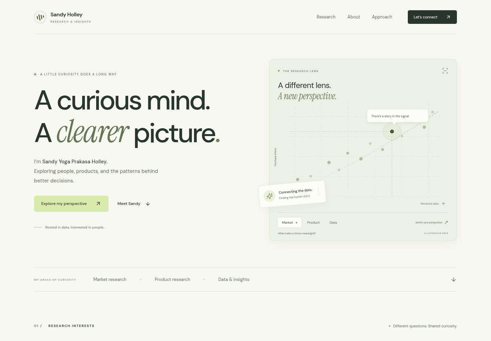

# Sandy Holley — Research & Insights

A personal portfolio for Sandy Yoga Prakasa Holley, focused on market, product, and data research. Built with React and Vite, with locally hosted fonts and custom SVG illustrations.



This image previews the design. For the interactive website, enable GitHub Pages using the instructions below.

## Develop

Requires Node.js 20.19+ or 22.12+ and npm.

```sh
npm ci
npm run dev
```

The development server binds to `0.0.0.0`, on port 5173 by default. Use the existing checkout in a cloud task; no additional Git worktree is needed.

## Build and validate

```sh
npm run build
npm run preview
npm test
```

Browser tests use `/usr/bin/chromium` when available. Else install Playwright's Chromium with `npx playwright install chromium`, or set `CHROMIUM_PATH` to an installed Chromium executable. Tests cover the research explorer, filters, modals, keyboard focus, approach sections, mobile navigation, clipboard, responsive layout, assets, and automated accessibility checks.

## Personalize

- `src/content.js` contains the name, optional email, LinkedIn URL, résumé URL, research interests, and approach text.
- Add contact details to `profile.email` and `profile.linkedIn` to activate the contact links. Until then, the page explicitly says contact details are coming soon.
- Put a résumé in `public/` and set `profile.resume` to its path (for example `/sandy-holley-resume.pdf`) to display the download link.
- The research cards describe interests and illustrative approaches, not completed projects. Replace them with verified case studies when project information is available. The hero plot uses illustrative data.
- Main page layout is in `src/main.jsx`; visual styles and responsive breakpoints are in `src/styles.css`.

## Deploy

Deploy the generated `dist/` directory to a static host. No API keys, backend, external font requests, or database are required. Contact links use email and LinkedIn directly; no messages are collected by the site.

### GitHub Pages

The `.github/workflows/deploy-pages.yml` workflow builds and deploys pushes to `main`.

1. Open the repository's **Settings → Pages**.
2. Under **Build and deployment → Source**, select **GitHub Actions**.
3. Open **Actions → Deploy portfolio to GitHub Pages** and choose **Run workflow**. Future pushes to `main` deploy automatically. If a run failed before Pages was enabled, rerun it.

The expected URL after a successful deployment is `https://sandy-yp-holley.github.io/Research-Portfolio/`. The workflow sets Vite's base path to the repository name so styles, scripts, and the favicon load at that URL.

To test the same build locally:

```sh
VITE_BASE_PATH=/Research-Portfolio/ npm run build
VITE_BASE_PATH=/Research-Portfolio/ npm run preview -- --port 4173
```

Request `/Research-Portfolio/` on the preview server. A regular `npm run build` still targets the root path for other hosting providers.
